# working_place

> A small set of **Claude Code mods**. Type `/mods` and a hub opens next to your session: live context/cost gauges, the status of every `claude agents` session, a session activity feed, a memo you can send to the session, Tetris, and an unofficial Pokémon collection game that grows with the tokens you spend.

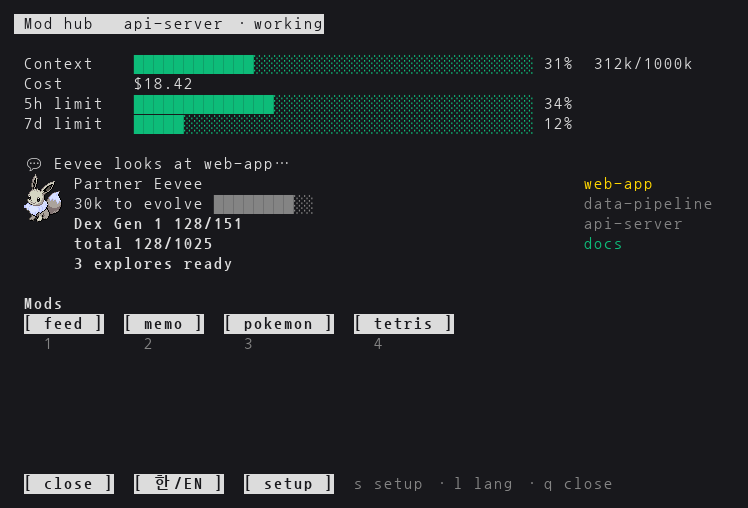

Every screen switches between English and Korean with the hub's `[ 한/EN ]` button.

## What's inside

| Plugin / mode | What it does |
|---|---|
| `pane-tools` | `/mods` opens the **hub** — even while the session is busy. Gauges, a partner Pokémon with a speech bubble, the awake sessions, and one button per mode. |
| ├ `feed` | **Session activity** — when each `claude agents` session finishes ✔, asks ▲ or starts ●, newest first, with its one-line summary. |
| ├ `memo` | A memo for the session. **send** queues it until the session is idle, then submits it. One memo per session. |
| ├ `tetris` | Tetris with hold (`c`). Draws a half-height board in short panes. |
| └ `pokemon` | Catch, evolve and battle with the tokens you spend — a fan-made game, see the [notice](#pokémon--unofficial-fan-project). |
| `long-run-watch` | Estimates how long a Bash command will take (median of its last runs, or "(about 30 min)" in the description), shows it in the status line and warns when it overruns. |

New modes are one file: drop a curses program at `pane-tools/bin/<name>.py` and the hub grows a `[ <name> ]` button. Files starting with `_` are helpers, not buttons. Text goes through `from _lang import L` → `L('한국어', 'English')`.

## The hub

- **Gauges** — context, cost and rate limits of the session it follows (each session's mod writes them every 2 s).
- **Speech bubble** — the partner reacts in one line: a session waiting for input (yellow after 10 minutes), ready to evolve, rewards, medals, gym badges and eggs, a session that just finished (it claps when it shipped a PR or a deploy), or rustling grass.
- **Sessions** — the awake `claude agents` sessions on the right, in the same colors as `claude agents` (needs yellow, working gray, completed green).
- **Partner art** — real sprites: Kitty graphics (cmux, Ghostty, kitty) or Sixel (Windows Terminal 1.22+, WezTerm, foot), detected automatically, `▀▄` blocks otherwise. Inside tmux the hub enables passthrough for its own pane only; add `set -as terminal-features ',xterm*:sixel'` to `~/.tmux.conf` (`install.sh --tmux-layout` does it).
- Keys work with a Korean keyboard layout too; on macOS with [`macism`](https://github.com/laishulu/macism) the hub switches to an English layout while focused.

### Session activity and memo

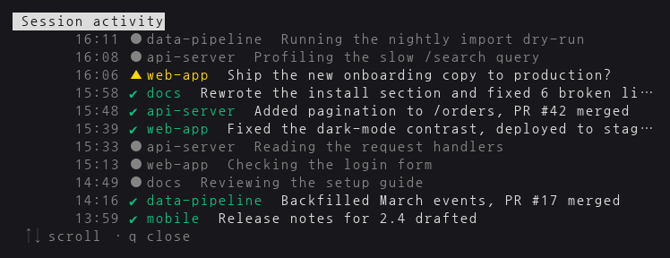

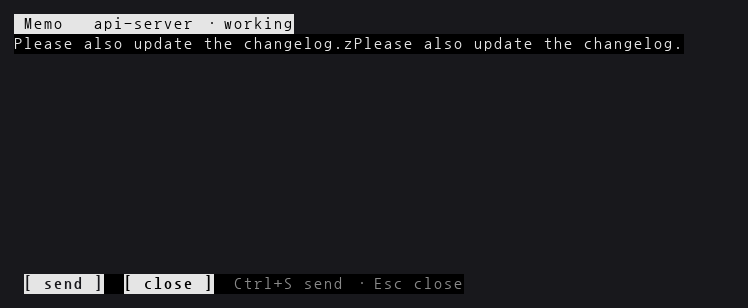

### Tetris

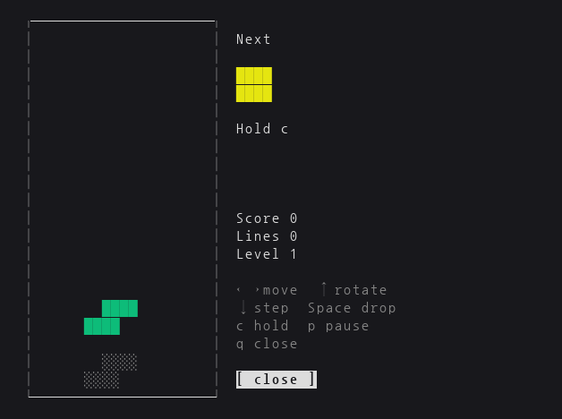

## Pokémon

Tokens you spend in Claude Code turn into encounters. Fill the Pokédex generation by generation (1–9); the next generation opens when you beat that generation's Elite Four and Champion **or** complete its Pokédex, whichever comes first. The grass shows the newest open generation; species left in older generations are still yours to finish through evolution.

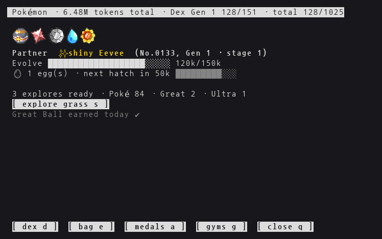

**Catching** — one explore every 30k tokens. Starters come first, legendaries and mythicals last. Three balls per encounter plus the ones you own:
Poké Ball, Great Ball (×1.5), Ultra Ball (×2) and Master Ball (always catches). A Poké Ball catches 35–70% depending on the species' original catch rate. Legendaries and mythicals only fall to Ultra or Master Balls.
A species already in your bag shows up rarely (1/10 of a new one) but can be caught again. A species that evolves from an earlier generation's Pokémon (Espeon and Umbreon from Eevee, Crobat from Golbat …) is mainly reached by evolution and shows up in the grass at 1/10 too — at full odds only once nothing else is left in its generation, so it never blocks the Pokédex.

**Bag and IVs** — every Pokémon rolls its own **IVs**: Attack, Defense and HP, 0–15 each, shown as `A13 D15 H14 (93%)` (★ at 15/15/15). Eggs, legendaries and mythicals roll at least 10. IVs add to battle stats, so two of the same species are worth comparing. The bag pages through all / each generation and sorts by Pokédex number, level, IVs or name.

**Trade** (between bag and medals) — **send** gives the highlighted Pokémon to the Professor for 1–5 Poké Balls (rarer is more); **tidy** sends every duplicate except the best-IV, most-trained ones. Both ask for a second press, and the partner, team members and shinies are never sent. The **balls** page swaps balls up a tier: 5 Poké → 1 Great, 20 Great → 1 Ultra, 5 Ultra → 1 Master (500 Poké Balls to a Master Ball).

**Rewards from work** — one Great Ball on any day a session finishes with a push, a PR merge or a deploy (read from the `claude agents` timelines; one per day). Three such days in a row (the 3rd, 6th, 9th day of a streak) bring an Ultra Ball.

**Eggs** — each wild catch has a 10% chance to come with an **egg** (up to three; the region conquest gives one too): a hidden first-stage species that hatches after its hatch steps × 5k tokens, shiny at 1/64, always with a bonus ball (Poké ×1 60% · ×2 20% · ×3 10% · Great 7% · Ultra 3%).

**Weekly challenge** — one task per week (changes on Monday, the same on every PC): catch 8, explore 15 times, win 5 gym/league/raid battles, evolve twice, ship on 4 days or hatch an egg. Finishing it gives 2 Ultra Balls, 3 Great Balls and a **Rare Candy**, which evolves your partner on the spot when it has a form to evolve into (one candy a week).

**Partner and evolution** — the partner gains the tokens you spend and evolves past a threshold. With several possible forms it picks one you don't have yet.

**Shinies** — 1/256 per encounter, counted apart from the normal form, shown in gold. Completing a generation gives that generation's **Shiny Charm** (I–IX), doubling the shiny rate for its species. One explore in five draws from all earlier generations instead (caught species and legendaries included), so a finished generation can still be shiny-hunted.

**Regional forms** — a side collection of 57 Alolan, Galarian, Hisuian and Paldean forms. Once a species' generation is behind you (Elite Four beaten or Pokédex complete), its regional forms join the earlier-generation explores (one in five) — evolved forms too, caught directly. A caught form goes into the bag like any other Pokémon — partner, evolution, levels, IVs, the Professor and battles all work, with the form's own types and base stats (generation and evolution stage come from the species). A form evolves into the same region's form (Alolan Rattata → Alolan Raticate, Galarian Slowpoke → Galarian Slowbro or Slowking) or into its region-only evolution (Galarian Meowth → Perrserker, Galarian Linoone → Obstagoon, Hisuian Sneasel → Sneasler, Paldean Wooper → Clodsire …); those evolutions follow the opened generations like any other. Forms stay out of the Pokédex count; the last page of the Pokédex (→ past the newest generation) lists them by species number like the other pages, and Enter opens a detail screen with the form's own types, height, weight, base stats, weaknesses and sprite (←→ steps through the forms you have seen; PokeAPI has no per-form category or entry, so those stay blank). No shiny forms; Galarian Articuno, Zapdos and Moltres need an Ultra or Master Ball.

**Fusion** — pick Kyurem, Necrozma or Calyrex in the bag and press **F** (the **fuse** button): it takes Zekrom or Reshiram (Black/White Kyurem), Solgaleo or Lunala (Dusk Mane/Dawn Wings Necrozma), Glastrier or Spectrier (Ice/Shadow Rider Calyrex) from the bag — the one with the best IVs, never your partner, a fusion you don't have yet first. The fused Pokémon battles with that form's own types and base stats and keeps the level, XP and IVs of Kyurem/Necrozma/Calyrex; **F** again splits it and the other one comes back to the bag. A fused Pokémon can't be sent to the Professor.

**Research** — every species has research tasks: catch 5 (legendaries 1), evolve once (if it evolves) and win 3 battles with it on the team. Finishing them stars the species in the Pokédex (★, with the count per generation in the header) and gives 2 Great Balls; the detail screen shows the progress. Pokémon caught before research existed count toward the catch task.

**Alphas** — about one explore in a hundred meets a red-eyed alpha (◆ in the bag): half the catch rate and only three throws before it flees, but its IVs start at 12.

**Raids** — each week (from Monday) one legendary from an opened generation sits at the top of the gym list. Beat it (any generation may enter — the place for the teams you maxed out earlier; 48× HP, two explores per try) to get three Raid Balls — your own balls don't work — and one chance to catch it; caught or missed, the raid ends for the week. If you are mid-encounter when you win, the boss waits until that one is over. **pick** draws from the whole bag here, and a win gives the team battle XP and research credit like a gym win.

**Medals** — 49 achievements (catches, generations, shinies, legendaries, evolutions, Great Balls, region conquests, champions, regional forms, fusion, research, alphas, raids), drawn with item sprites. Pick up to five medals or gym badges in the medal screen to show at the top of the Pokémon screen.

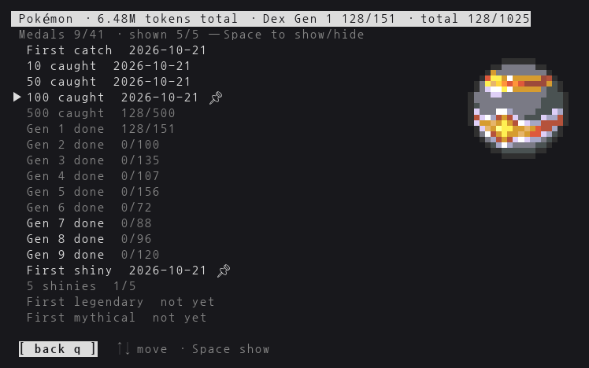

**Pokédex** — each uncaught entry shows how to get it (wild · evolve from … · legendary/mythical), and the bottom line counts what is left in the wild, evolve-only and legendary, plus who is in the grass right now. Pick a species and press Enter (←→ switches generation): category, types, height and weight, base stats, weaknesses (×4 marked), resistances and immunities, the Pokédex entry and a crisp sprite.

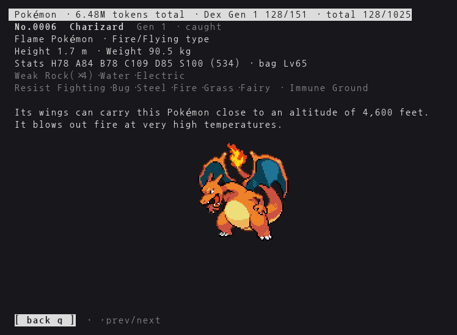

### Gyms, Elite Four and Champion

Eight gyms per opened generation, in the original type order (Alola uses its trial types). Build a team of up to six with Space in the bag or let the gym screen suggest one (**pick**, then **apply**): it shortlists twelve by type matchup × actual stats (so level and IVs count), then adds one at a time whichever raises the simulated win rate most. That is near-best rather than every combination tried; when nothing wins at all, the shortlist order decides. **Only that generation's Pokémon can enter** a generation's gyms and Elite Four (others on the team sit out), so each region needs a team of its own.

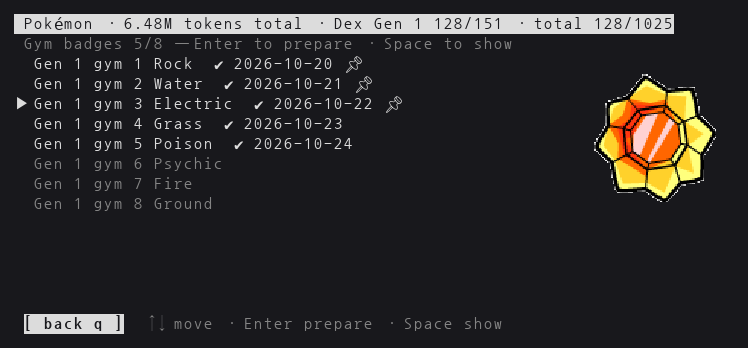

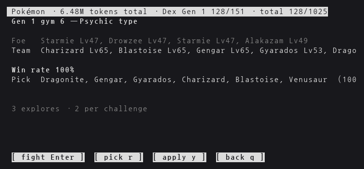

A challenge costs two explores and plays a fully automatic battle line by line: base stats, level (15 + 12 per evolution stage + one per 50 battle XP, up to +40; a loss gives the team +30 XP, a win +60 + 10 × gym number — the bag shows each Pokémon's progress like `Lv16 (10/50)`), IVs (Attack → Atk/Sp. Atk, Defense → Def/Sp. Def, HP → HP), each Pokémon's own type attack, type matchups and speed. Gym and league trainers are 7 levels above the original curve and have IVs of their own (gym 1 at 7 up to gym 8 at 14, Elite Four 14, Champion 15): at matched levels an average-IV team usually loses the league and a top-IV team usually wins. The first win gives that gym's **badge** (the real badge art); every battle gives the team experience. After a win `q` goes straight back to the hub, after a loss back to the prep screen.

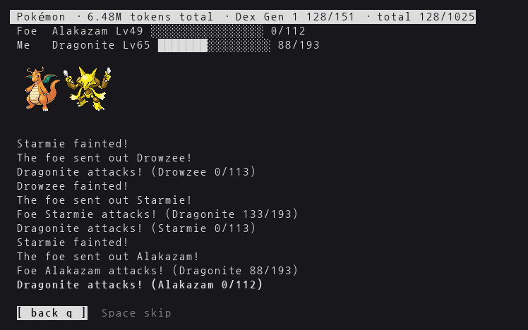

Each gym's first win gives an Ultra Ball. Clearing all eight gyms of a generation gives the region conquest medal, a Master Ball and an egg — and opens that generation's **Elite Four and Champion**: five battles in a row (four members with four Pokémon each, a champion with six), four explores per run. The first clear gives the champion medal and a Master Ball — two Master Balls per generation.

**Controls** — arrow keys, Enter and `q`, plus Space, Tab and F in the bag. The mouse works too.

| Screen | Keys |
|---|---|
| Most screens | arrows move between buttons, Enter presses one, `q` goes back or closes |
| Lists (medals, gyms, trade) | ↑↓ picks the row, ←→ the button below it, which acts on that row |
| Bag | ↑↓ row · Enter makes it your partner · Space adds it to / removes it from the team · ←→ all / each generation · Tab sort: Pokédex number (default), level, IVs, name (가나다 in Korean, abc in English) — remembered per PC, the trade screen follows it · F fuses / splits Kyurem, Necrozma, Calyrex |
| Pokédex | ←→ generation (the last page is regional forms) · Enter details, where ←→ steps through species |

Every screen fits the pane: long lines wrap at spaces, buttons lose their padding below 80 columns, and below 50 the ` q` hints go and bag rows shorten.

## Install

### Marketplace (just use it)

Requires [Claude Code](https://docs.claude.com/claude-code) and `python3` (tmux is optional).

```
/plugin install pane-tools --marketplace Shin-junyeob/working_place
/plugin install long-run-watch --marketplace Shin-junyeob/working_place
```

From a shell: `claude plugin install pane-tools --marketplace Shin-junyeob/working_place`. Then type `/mods` in any session.
Auto-update is off for third-party marketplaces: turn it on in `/plugin` → Marketplaces → `working-place`, or run `claude plugin update pane-tools@working-place`.

### Clone (hack on it, keep several PCs in sync)

```bash
git clone https://github.com/Shin-junyeob/working_place.git ~/.claude/mods
bash ~/.claude/mods/install.sh                   # load this folder in every new session + self-check
bash ~/.claude/mods/install.sh --tmux-layout     # optional: tmux mouse, Sixel passthrough, the `sett` layout
bash ~/.claude/mods/install.sh --pokemon-backup  # optional: back up the Pokémon save daily at 17:59
bash ~/.claude/mods/install.sh --auto-pull       # optional: pull new commits from GitHub at boot and every 10 minutes
```

`install.sh` sets `CLAUDE_CODE_PLUGIN_DIRS` in `~/.claude/settings.json`, so every new session loads these mods and reloads them when a file changes. Don't enable the marketplace copy at the same time. `--auto-pull` adds two cron lines: one every 10 minutes and one `@reboot` that runs as soon as the machine (or WSL) starts, retrying every 2 s for up to 2 minutes until the network is up. It skips when there are local edits or unpushed commits and logs to `~/.claude/pane-tools/autopull.log`. An open hub restarts itself when any file in `pane-tools/bin/` changes; an open mode screen (Pokémon, Tetris…) gets the new code the next time you open it.

The `sett` layout (`--tmux-layout`) is `claude agents` on the left and, on the right, a spare shell, the activity feed and the hub — both started automatically.

## Where the hub opens

Choose in the hub's **setup** (`s`) or in `/config` → pane-tools; the hub's choice wins and applies from the next `/mods`.

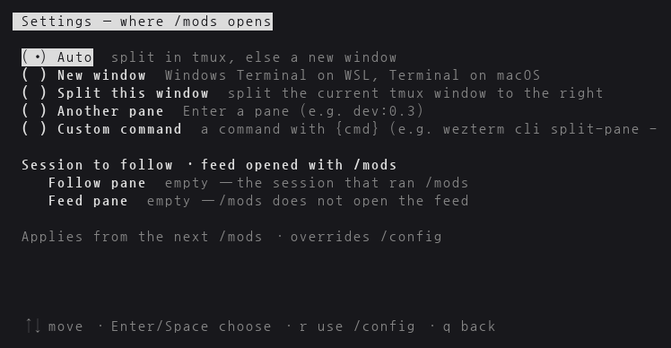

| Option | Value | Behavior |
|---|---|---|
| `launcher` | `auto` (default) | split the current tmux window, or open a new terminal window outside tmux |
| | `tmux` | `tmuxTarget` empty → split the current window; set (e.g. `dev:0.3`) → replace that pane when it is an idle shell or the hub |
| | `window` | a new terminal window — Windows Terminal on WSL, Terminal on macOS, `x-terminal-emulator` on Linux |
| | `command` | your own command; `{cmd}` becomes the hub command, e.g. `wezterm cli split-pane -- bash -lc {cmd}` or `zellij run -- bash -lc {cmd}` |
| `followPane` | empty (default) | follow the session that ran `/mods` |
| | e.g. `dev:0.0` / `cmux:0` | follow whichever Claude session is open in that pane |
| `feedTarget` | e.g. `dev:0.2` | `/mods` also opens the activity feed there when that pane is an idle shell |

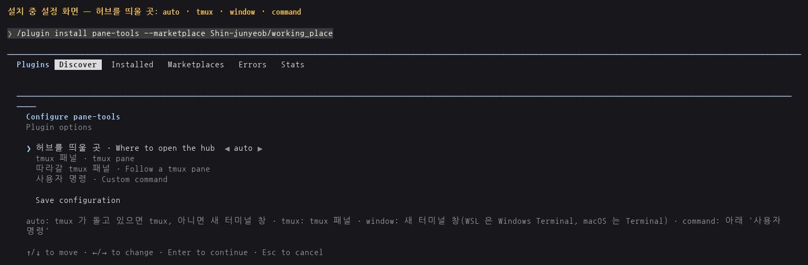

## Data on disk

Nothing below is in the repository. Everything lives in `~/.claude/pane-tools/`:
`settings.json` (language, hub setup, bag sort), `pokemon.json` (your progress), `pokedex.json` · `pokedex_detail.json` · `battle.json` · `forms.json` (data from PokeAPI), `sprites/` (Pokémon, `shiny/`, gym `badges/`, `items/` — fetched from PokeAPI one by one when first shown), `memos/`, `usage/` (gauges and token counts per session), `inbox/` (memos waiting to be sent).

## Pokémon — unofficial fan project

- This is an **unofficial, non-commercial fan project**. It is not affiliated with, endorsed or sponsored by Nintendo, Creatures, GAME FREAK or The Pokémon Company. Pokémon and Pokémon character names are trademarks of their respective owners.
- **No Pokémon data or images ship in this repository.** Everything is downloaded on your machine from [PokeAPI](https://pokeapi.co/):
  - data — the public CSVs in [PokeAPI/pokeapi](https://github.com/PokeAPI/pokeapi) (`data/v2/csv`): names, generations, evolutions, capture rates, baby/hatch info, Pokédex entries, base stats, type matchups and regional forms;
  - images — [PokeAPI/sprites](https://github.com/PokeAPI/sprites): `sprites/pokemon/<id>.png`, `sprites/pokemon/shiny/<id>.png`, `sprites/badges/<n>.png` and `sprites/items/<name>.png`, each fetched the first time it is shown.
  - The code only holds sprite numbers and names, the gym/Elite Four type tables and the game rules. Re-download the data with `python3 pane-tools/bin/_pokedata.py`.
- The screenshots in `docs/images/` are captures of this program running in a test environment; the sprites in them were drawn from PokeAPI at runtime.
- The Pokémon mode will be taken down on request from the rights holders.

## Development

- Self-checks: `python3 pane-tools/bin/<name>.py --selftest` for `memo`, `tetris`, `hub`, `feed` and `pokemon` (after the Pokédex has been downloaded once); `python3 pane-tools/bin/_battle.py` (battle rules) and `python3 pane-tools/bin/_place.py` (hub setup); `claude plugin test pane-tools` and `claude plugin test long-run-watch`.
- Bump `version` in the plugin's `.claude-plugin/plugin.json` so marketplace users see the update.

## License

MIT — see `LICENSE`. Pokémon names, PokeAPI data and sprites (Pokémon, badges, items) are not covered.
