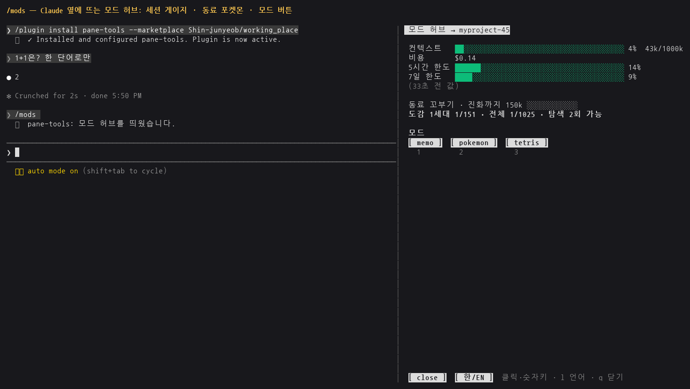
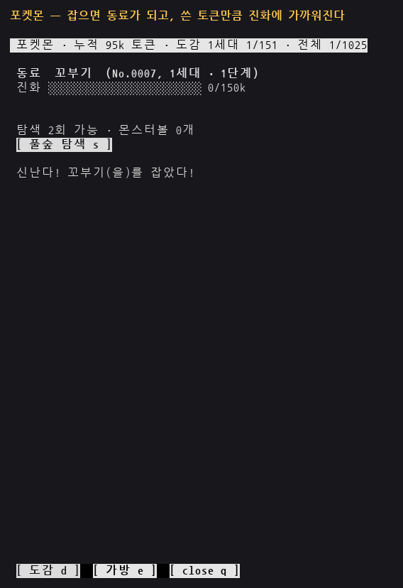
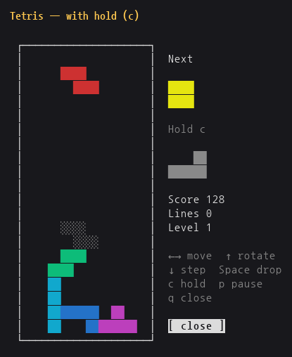
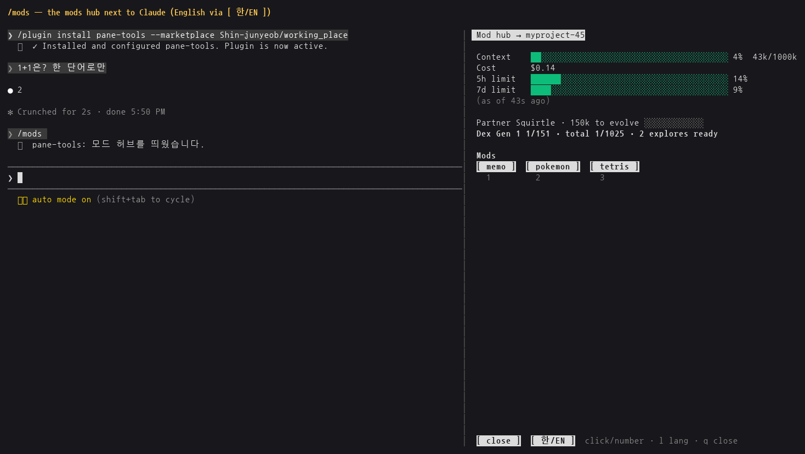

# working_place
> Claude Code 에서 `/mods` 한 번으로 여는 **모드 허브** — 세션의 컨텍스트·비용 게이지, 세션에 보낼 메모장, 기다리는 동안의 테트리스·포켓몬.
> 한국어 / English — 허브의 `[ 한/EN ]` 버튼 하나로 mods 전체 글자가 바뀝니다. *(English summary below.)*



## 들어 있는 것
| 플러그인 | 하는 일 |
|------|---------|
| `pane-tools` | `/mods` 를 입력하면(세션이 작업 중이어도 바로) 허브가 뜬다. 위에는 세션의 컨텍스트·비용·사용 한도 게이지와 동료 포켓몬, 아래에는 모드 버튼. 오른쪽 빈자리에는 `claude agents` 의 깨어 있는 세션 이름이 같은 색으로 한 줄씩(needs 노랑 · working 회색 · completed 녹색) — 다른 세션이 끝났는지 들어가 보지 않아도 된다. 허브·포켓몬·테트리스의 단축키는 한글 자판인 채로 눌러도 먹는다(ㅣ→l 처럼 같은 자리 영문 키로). 다만 한글 입력기는 자모 하나를 '조합 중'으로 잡아 두어 두 번 눌러야 하므로, macOS 에서 [`macism`](https://github.com/laishulu/macism)(`brew install laishulu/homebrew/macism`)이 있으면 허브 패널에 들어올 때 영문 자판으로 바꾸고 나갈 때(·메모장을 열 때·허브를 닫을 때) 원래 자판으로 되돌린다 — 터미널의 포커스 신호를 쓴다 |
| ├ `feed` | 세션 활동 피드 — `claude agents` 세션들이 끝내거나(✔) 묻거나(▲) 시작한(●) 순간을 그 한 줄 요약과 함께 최근 것부터. 데몬이 남기는 `~/.claude/jobs/*/timeline.jsonl` 을 읽기만 한다. `sett` 는 2번 패널에 이걸 띄운다 |
| ├ `memo` | 세션에 보낼 메모장. [send] 하면 그 세션이 작업 중이면 끝난 뒤 들어간다. 세션마다 메모가 따로 |
| ├ `tetris` | 테트리스. `c` 로 블럭 1개 보관. 패널이 22줄보다 낮으면 판을 반높이(12줄)로 그린다 |
| └ `pokemon` | 쓴 토큰만큼 포켓몬을 발견·포획·진화시켜 1~9세대 도감을 채운다(비공식 팬메이드 — 아래 참고)<br>· 규칙: 가방에 있는 종은 다른 종의 1/10 확률로만 나온다(나오면 몬스터볼로) · 잡을 때마다 몬스터볼 +1 · 진화형이 이미 가방에 있으면 그 모습으로는 진화하지 않는다<br>· 볼: 몬스터볼(b) · 슈퍼볼(u, 1.5배) · 하이퍼볼(h, 2배). 전설·환상은 하이퍼볼로만 잡힌다. 하이퍼볼은 가방(e)에서 몬스터볼 100개로 교환(x). 슈퍼볼은 일한 보상 — 하루에 서로 다른 세션 3개 이상이 PR 병합·배포가 든 completed 를 내면 1개(하루 1개, `~/.claude/jobs` 기록을 읽는다)<br>· 이로치: 1/256 확률, 같은 종의 기본 모습이 가방에 있어도 따로 잡을 수 있다(이로치끼리만 중복). 이름은 금색, 동료 그림도 이로치 도트<br>· 그림: 허브에 동료 도트를 3줄 크기로 — Kitty 그래픽 터미널(cmux·Ghostty·kitty)은 원본 그대로, Sixel 터미널(Windows Terminal 1.22+·WezTerm·foot 등)은 Sixel 이미지(1.5줄)로, 둘 다 아니면 `▀▄` 칸 — 터미널에 물어 저절로 고른다. tmux 안에서는 tmux 3.4 가 바깥 칸 크기를 몰라 그림을 'SIXEL IMAGE' 글자로 바꾸므로, 허브가 **자기 패널만** passthrough 를 켜고 그림을 터미널로 바로 보낸다. 감지를 위해 `~/.tmux.conf` 에 `set -as terminal-features ',xterm*:sixel'`(`install.sh --tmux-layout` 이 넣어 줌) 후 tmux 에 다시 붙기 · 포켓몬 모드 `c` 로 컬러/회색(PC마다) |
| `long-run-watch` | 오래 걸리는 Bash 명령에 예상 시간·초과 경고·끝남 알림 |

<p> </p>

새 모드는 `pane-tools/bin/<이름>.py` (curses 프로그램) 하나만 두면 허브에 `[ <이름> ]` 버튼이 저절로 생긴다. `_` 로 시작하는 파일은 버튼이 안 된다. 글자는 `from _lang import L` 후 `L('한국어', 'English')`.

## 설치 1 — 마켓플레이스 (그냥 쓰기)
준비: [Claude Code](https://docs.claude.com/claude-code), `python3`. (tmux 는 선택)

Claude Code 프롬프트에서:
```
/plugin install pane-tools --marketplace Shin-junyeob/working_place
/plugin install long-run-watch --marketplace Shin-junyeob/working_place
```
셸에서는 `claude plugin install pane-tools --marketplace Shin-junyeob/working_place`.
데스크톱 앱에서는 프롬프트 옆 **+** → Plugins → Add marketplace `Shin-junyeob/working_place` → Add plugin.

그다음 아무 세션에서 `/mods`.

**자동 업데이트:** 직접 만든 마켓은 자동 업데이트가 기본으로 꺼져 있다. `/plugin` → Marketplaces → `working-place` 에서 자동 업데이트를 켜거나, 손으로 `claude plugin update pane-tools@working-place`.

## 허브를 어디에 띄울지 — 허브의 `[ 설정 ]` 또는 `/config` → pane-tools
허브 아래줄의 `[ 설정 ]`(`s` 키)에서 **자동 · 새 창 · 현재 창에 서브패널 · 다른 패널 · 사용자 명령**과 따라갈 패널을 고른다. 고른 값은 `~/.claude/pane-tools/settings.json` 에 적혀 `/config` 보다 먼저 쓰이고, 바로 다음 `/mods` 부터 적용된다(`r` 로 지우면 다시 `/config`). 설치할 때도 같은 `/config` 설정 화면이 나온다.


| 설정 | 값 | 동작 |
|------|----|------|
| `launcher` | `auto` (기본) | tmux 가 돌고 있으면 tmux, 아니면 새 터미널 창 |
| | `tmux` | tmux 패널 — `tmuxTarget` 이 비면 지금 창을 오른쪽으로 나눠 새 패널, 값(예: `dev:0.3`)이 있으면 그 패널을 갈아 끼운다(빈 셸이거나 허브일 때만) |
| | `window` | 새 터미널 창 — WSL 은 Windows Terminal, macOS 는 Terminal, 리눅스는 `x-terminal-emulator` |
| | `command` | 내 명령으로 — `command` 의 `{cmd}` 자리에 허브 실행 명령(따옴표로 감싼 한 덩어리)이 들어가 bash 로 돈다 |
| `followPane` | 비움 (기본) | 허브·메모가 **`/mods` 를 입력한 세션**을 따라간다 |
| | 예: `dev:0.0` | 그 tmux 패널에 열린 Claude 세션(예: `claude agents`)을 따라간다 — 세션을 바꾸면 허브도 바뀐다 |
| | 예: `cmux:0` | cmux 에서는 패널 번호로 — 허브가 떠 있는 워크스페이스의 0번 패널에 열린 세션을 따라간다(cmux 를 다시 켜도 번호는 그대로) |
| `feedTarget` | 비움 (기본) · 예: `dev:0.2` | `/mods` 때 그 tmux 패널이 빈 셸이면 세션 활동 피드도 띄운다(이미 피드가 돌면 그대로, 다른 프로그램이면 건드리지 않음) |

`command` 예:
- WezTerm: `wezterm cli split-pane -- bash -lc {cmd}`
- Zellij: `zellij run -- bash -lc {cmd}`
- cmux 등 다른 도구: 그 도구의 "새 패널(분할)에서 명령 실행" 문법에 `bash -lc {cmd}` 를 넣는다

## 설치 2 — clone (고치고 여러 PC 에서 맞추기)
```bash
git clone https://github.com/Shin-junyeob/working_place.git ~/.claude/mods
bash ~/.claude/mods/install.sh                     # 세션마다 이 폴더를 자동으로 불러오게 + 자체 점검
bash ~/.claude/mods/install.sh --tmux-layout       # (선택) tmux 마우스·sett 레이아웃(0 claude agents · 1 셸 · 2 활동 피드 · 3 허브, 둘 다 바로 뜸)
bash ~/.claude/mods/install.sh --pokemon-backup    # (선택) 매일 17:59 포켓몬 기록 백업
bash ~/.claude/mods/install.sh --auto-pull         # (선택) 10분마다 GitHub 에서 새 커밋을 받아 옴
```
이 방식은 `~/.claude/settings.json` 의 `env` 에 `CLAUDE_CODE_PLUGIN_DIRS` 를 넣어, **새로 여는 세션마다 이 폴더의 mod 가 붙고 파일을 고치면 저절로 다시 불러온다**. 마켓에서 설치한 같은 플러그인과 함께 켜지 않는다(두 번 걸린다).
고친 것은 `git pull` / `git push` 로 PC 끼리 맞춘다. `--auto-pull` 을 켜면 받아 오기는 저절로 된다(이 PC 에 커밋 안 한 수정이나 안 올린 커밋이 있으면 건너뛰고 `~/.claude/pane-tools/autopull.log` 에 남김). 다른 사람은 fork 나 Pull Request 로 제안할 수 있다.

## 기록은 어디에 (저장소에 안 들어감)
`~/.claude/pane-tools/` — `settings.json`(한/영·동료 그림 컬러/회색·허브 [ 설정 ] 의 띄울 곳), `pokemon.json`(포켓몬 진행), `pokedex.json`(PokeAPI 에서 받은 도감), `sprites/`(동료 그림 — 필요할 때 한 장씩 받음), `memos/`, `usage/`(세션별 게이지·누적 토큰), `inbox/`(보낼 메모).

## 포켓몬 — 비공식 팬메이드
- 이 프로젝트는 **비공식 팬메이드**이며 Nintendo · Creatures · GAME FREAK · The Pokémon Company 와 관계가 없고, 이들의 승인이나 후원을 받지 않았습니다. 포켓몬과 각 포켓몬 이름은 해당 권리자의 상표입니다. 비영리 목적으로만 만들었습니다.
- 저장소에는 포켓몬 데이터가 **들어 있지 않습니다**. `pokemon` 모드를 처음 열 때 [PokeAPI](https://pokeapi.co/) 의 공개 데이터(CSV)에서 이름(한·영)·세대·진화 관계·포획률을 받아 각자의 PC(`~/.claude/pane-tools/pokedex.json`)에 만듭니다. 다시 받으려면 `python3 pane-tools/bin/_pokedata.py`.
- 권리자의 요청이 있으면 이 모드는 내립니다.

## 점검
스크린샷은 빈 홈 폴더의 새 사용자 환경에서 마켓 설치 → `/mods` 로 찍었다(포켓몬 탐색 기회만 시험용 토큰 기록으로 채움).
`python3 pane-tools/bin/<이름>.py --selftest`, `claude plugin test pane-tools`, `claude plugin test long-run-watch`

## 라이선스
MIT — `LICENSE`. (포켓몬 관련 명칭과 PokeAPI 데이터는 이 라이선스에 포함되지 않습니다.)

---

## English summary


**working_place** is a Claude Code mod set. Type `/mods` (works even while the session is busy) to open a hub showing the session's context/cost/rate-limit gauges, the status of every awake `claude agents` session (needs yellow, working gray, completed green) and buttons for small tools: a memo you can send to the session (queued until it is idle), Tetris (with hold), and an unofficial Pokémon collection game fed by the tokens you spend (Great Balls for days when 3+ sessions ship a PR/deploy, Ultra Balls for 100 Poké Balls, 1/256 shinies in gold). `long-run-watch` estimates long Bash commands and warns when they overrun. The `[ 한/EN ]` button switches every screen between Korean and English.

**Install:** `/plugin install pane-tools --marketplace Shin-junyeob/working_place` (and `long-run-watch`), then `/mods`. Requires `python3`.
**Where it opens:** the hub's `[ setup ]` button (`s`) — auto / new window / split this window / another pane / custom command, plus the pane to follow; saved in `~/.claude/pane-tools/settings.json`, it overrides `/config` from the next `/mods`. Or `/config` → pane-tools → `launcher` = `auto` · `tmux` (split, or replace `tmuxTarget`) · `window` (Windows Terminal / macOS Terminal / x-terminal-emulator) · `command` (your own command with a `{cmd}` placeholder, e.g. `wezterm cli split-pane -- bash -lc {cmd}`). `followPane` makes the hub follow the Claude session shown in a pane (tmux `dev:0.0`, or cmux `cmux:0` = pane 0 of the hub's workspace); empty = the session that ran `/mods`.
**Add a mode:** drop `pane-tools/bin/<name>.py` (a curses program); the hub shows a `[ <name> ]` button.
**Pokémon notice:** unofficial, non-commercial fan project, not affiliated with or endorsed by Nintendo, Creatures, GAME FREAK or The Pokémon Company. No Pokémon data ships in this repo; it is downloaded from [PokeAPI](https://pokeapi.co/) on first use. It will be taken down on request from the rights holders.
**License:** MIT (Pokémon names and PokeAPI data are not covered).
